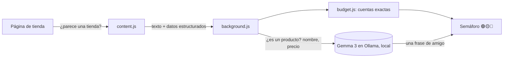

# FinDeMes 💸

**¿Me lo puedo permitir?** Una extensión de navegador que, cuando estás mirando un producto en cualquier tienda online, te enseña un semáforo:

- 🟢 **Te lo puedes permitir**: entra en tu ritmo de gasto del mes.
- 🟡 **Puedes, pero te aprieta**: te dice cuánto te quedaría al día hasta que cobres y cuántos días esperar para que entre en tu ritmo.
- 🔴 **Ahora no**: te dice en cuántos meses podrías comprarlo sin tocar tus ahorros.

La hice para un amigo que nunca llega a fin de mes.

## Por qué IA abierta y local

FinDeMes ve **todas las tiendas que visitas** y conoce **tu sueldo, tus gastos y tus ahorros**. Esos datos no deberían salir de tu ordenador.
Por eso la IA es [Gemma 3](https://ollama.com/library/gemma3) corriendo en local con [Ollama]: funciona sin cuentas ni claves de API, no cuesta nada y ninguna página ni ningún número tuyo se envía a ningún servidor.

## Cómo funciona



1. `content.js` solo despierta a la IA si la página tiene pinta de tienda (precios, botón de comprar o datos de producto).
2. **Gemma** lee el texto de la página y decide si es la ficha de un producto, cuál es y su precio real (no el tachado ni el del envío). Así funciona en cualquier tienda, sin programar un lector para cada web. Si la tienda publica datos estructurados (`schema.org/Product`), se usan directamente para ir más rápido.
3. `budget.js` hace las cuentas. Esto **no** lo hace la IA, porque tienen que ser exactas:
   - Dinero libre = ingresos − gastos fijos − ahorro.
   - Ritmo de gasto: el dinero libre se "gana" día a día desde que cobras. El día 3 no te has ganado lo mismo que el día 28.
   - Con el botón **Lo he comprado** apuntas el gasto y se resta del mes.
4. Gemma escribe además una frase corta y sincera, como lo diría un amigo.

## Instalación

1. Instala [Ollama](https://ollama.com) y descarga el modelo:
   ```
   ollama pull gemma3:4b
   ```
2. Permite que las extensiones hablen con Ollama y reinícialo:
   - Windows (PowerShell): `[Environment]::SetEnvironmentVariable("OLLAMA_ORIGINS","chrome-extension://*","User")`
   - macOS: `launchctl setenv OLLAMA_ORIGINS "chrome-extension://*"`
   - Linux: `OLLAMA_ORIGINS="chrome-extension://*" ollama serve`
3. En Chrome o Edge abre `chrome://extensions`, activa **Modo desarrollador**, pulsa **Cargar descomprimida** y elige la carpeta `extension/`.
4. Rellena tus números en la página de configuración que se abre sola.

Si tu ordenador va justo, en la configuración puedes cambiar el modelo por `gemma3:1b`.

## Licencia

MIT

[Ollama]: https://ollama.com
