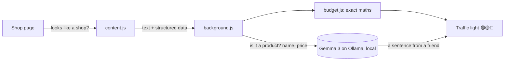

# Should I Buy 💸

[English](#english) · [Español](#español)

## English

**Can I afford it?** A browser extension that shows you a traffic light whenever you're looking at a product in any online shop:

- 🟢 **You can afford it**: it fits your spending pace for the month.
- 🟡 **You can, but it's tight**: it tells you how much you'd have left per day until payday, and how many days to wait for it to fit your pace.
- 🔴 **Not now**: it tells you how many months it would take to buy it without touching your savings.

I built it for a friend who never makes it to the end of the month.

### Why open, local AI

Should I Buy sees **every shop you visit** and knows **your income, your expenses and your savings**. That data shouldn't leave your computer.
That's why the AI is [Gemma 3](https://ollama.com/library/gemma3) running locally with [Ollama]: no accounts, no API keys, no cost, and no page or number of yours is ever sent to a server.

### How it works



1. `content.js` only wakes the AI up if the page looks like a shop (prices, a buy button, or product data).
2. **Gemma** reads the page text and decides whether it's a single product page, which product it is and its real price (not the crossed-out one, nor shipping). This way it works on any shop without writing a scraper per site. If the shop publishes structured data (`schema.org/Product`), it's used directly to save time.
3. `budget.js` does the maths. The AI does **not** do this part, because it has to be exact:
   - Free money = income − fixed expenses − savings.
   - Spending pace: your free money is "earned" day by day from payday. On day 3 you haven't earned as much as on day 28.
   - The **I bought it** button logs the purchase and subtracts it from the month.
4. Gemma also writes a short, honest sentence, the way a friend would say it.

### Installation

1. Install [Ollama] and download the model:
   ```
   ollama pull gemma3:4b
   ```
2. Allow browser extensions to talk to Ollama, then restart it:
   - Windows (PowerShell): `[Environment]::SetEnvironmentVariable("OLLAMA_ORIGINS","chrome-extension://*","User")`
   - macOS: `launchctl setenv OLLAMA_ORIGINS "chrome-extension://*"`
   - Linux: `OLLAMA_ORIGINS="chrome-extension://*" ollama serve`
3. In Chrome or Edge open `chrome://extensions`, turn on **Developer mode**, click **Load unpacked** and choose the `extension/` folder.
4. Fill in your numbers on the settings page that opens automatically.

If your computer struggles, you can switch the model to `gemma3:1b` in the settings.

### License

MIT

---

## Español

**¿Me lo puedo permitir?** Una extensión de navegador que, cuando estás mirando un producto en cualquier tienda online, te enseña un semáforo:

- 🟢 **Te lo puedes permitir**: entra en tu ritmo de gasto del mes.
- 🟡 **Puedes, pero te aprieta**: te dice cuánto te quedaría al día hasta que cobres y cuántos días esperar para que entre en tu ritmo.
- 🔴 **Ahora no**: te dice en cuántos meses podrías comprarlo sin tocar tus ahorros.

La hice para un amigo que nunca llega a fin de mes.

### Por qué IA abierta y local

Should I Buy ve **todas las tiendas que visitas** y conoce **tu sueldo, tus gastos y tus ahorros**. Esos datos no deberían salir de tu ordenador.
Por eso la IA es [Gemma 3](https://ollama.com/library/gemma3) corriendo en local con [Ollama]: funciona sin cuentas ni claves de API, no cuesta nada y ninguna página ni ningún número tuyo se envía a ningún servidor.

### Cómo funciona

1. `content.js` solo despierta a la IA si la página tiene pinta de tienda (precios, botón de comprar o datos de producto).
2. **Gemma** lee el texto de la página y decide si es la ficha de un producto, cuál es y su precio real (no el tachado ni el del envío). Así funciona en cualquier tienda, sin programar un lector para cada web. Si la tienda publica datos estructurados (`schema.org/Product`), se usan directamente para ir más rápido.
3. `budget.js` hace las cuentas. Esto **no** lo hace la IA, porque tienen que ser exactas:
   - Dinero libre = ingresos − gastos fijos − ahorro.
   - Ritmo de gasto: el dinero libre se "gana" día a día desde que cobras. El día 3 no te has ganado lo mismo que el día 28.
   - Con el botón **I bought it** apuntas el gasto y se resta del mes.
4. Gemma escribe además una frase corta y sincera, como lo diría un amigo.

### Instalación

1. Instala [Ollama] y descarga el modelo:
   ```
   ollama pull gemma3:4b
   ```
2. Permite que las extensiones hablen con Ollama y reinícialo:
   - Windows (PowerShell): `[Environment]::SetEnvironmentVariable("OLLAMA_ORIGINS","chrome-extension://*","User")`
   - macOS: `launchctl setenv OLLAMA_ORIGINS "chrome-extension://*"`
   - Linux: `OLLAMA_ORIGINS="chrome-extension://*" ollama serve`
3. En Chrome o Edge abre `chrome://extensions`, activa **Modo desarrollador**, pulsa **Cargar descomprimida** y elige la carpeta `extension/`.
4. Rellena tus números en la página de configuración que se abre sola.

Si tu ordenador va justo, en la configuración puedes cambiar el modelo por `gemma3:1b`.

### Licencia

MIT

[Ollama]: https://ollama.com
